<p align="center">
  
</p>

# Phát hiện Giao dịch Thẻ tín dụng Gian lận (Credit Card Fraud Detection)

**Bài tập lớn — Học phần Nhập môn Học máy (Năm học 2026–2027)**  
**Giảng viên hướng dẫn:** ThS. Lê Thị Thùy Trang  
**Nhóm 12 — Đề tài 12:**  
– **Trần Quang Lương** *(EDA, thiết kế cấu trúc dự án, phân tích rò rỉ dữ liệu)*  
– **Nguyễn Văn Hiếu** *(Tiền xử lý Luồng A vs Luồng B, kỹ thuật đặc trưng chống Data Leakage, huấn luyện & tinh chỉnh Decision Tree (max_depth=6))*  
– **Vũ Văn Chiến** *(Huấn luyện, tinh chỉnh siêu tham số K-NN, Naive Bayes & Ensemble mở rộng)*  
– **Nguyễn Giang Nam** *(Đánh giá, Error Analysis, ứng dụng Demo GUI, tổng hợp báo cáo LaTeX & tài liệu)*  

---

## 1. Giới thiệu bài toán & Nguồn dữ liệu

– **Mục tiêu:** Xây dựng pipeline học máy hoàn chỉnh nhằm phát hiện và phân loại các giao dịch thẻ tín dụng hợp lệ (`Class = 0`) và gian lận (`Class = 1`) trên tập dữ liệu dạng bảng có độ mất cân bằng cực đoan.  
– **Nguồn dữ liệu:** Tệp `creditcard.csv` theo chỉ định của Đề tài 12 (nguồn gốc: ULB Machine Learning Group / [Kaggle Credit Card Fraud Detection](https://www.kaggle.com/datasets/mlg-ulb/creditcardfraud)).  
– **Quy mô:** `284.807` giao dịch × `31` cột (`Time`, `V1`–`V28` thu được từ phép chiếu PCA ẩn danh, `Amount`, `Class`).  
– **Đặc điểm dữ liệu:** Không chứa giá trị rỗng (NaN/Null), có `1.081` bản ghi trùng lặp và tỉ lệ gian lận cực kỳ hiếm `0.1727%` (`492` mẫu gian lận trên tổng số `284.807` giao dịch).  
– *(Tệp dữ liệu gốc dung lượng ~144 MB không được đưa lên GitHub; xem hướng dẫn tải tại [data/README.md](data/README.md)).*  

---

## 2. Kiến trúc Tổng quan Pipeline (End-to-End Architecture)

Pipeline được thiết kế nghiêm ngặt nhằm đảm bảo **chống rò rỉ dữ liệu (Data Leakage)** tuyệt đối bằng cách phân tách tập dữ liệu (`Train / Validation / Test`) trước khi thực hiện bất kỳ phép chuẩn hóa hay biến đổi nào.

<p align="center">
  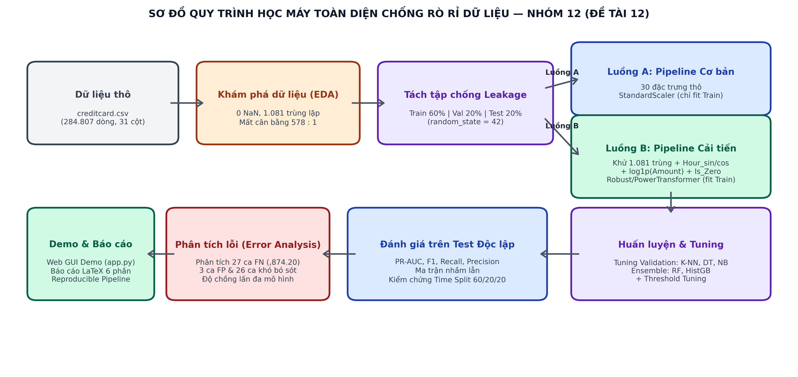
</p>

---

## 3. Khám phá & Phân tích Dữ liệu (EDA)

### 3.1. Phân phối nhãn & Đặc trưng giao dịch
Dữ liệu có độ mất cân bằng nghiêm trọng (tỉ lệ 578:1 giữa giao dịch thường và gian lận). Số tiền giao dịch (`Amount`) của các vụ gian lận thường tập trung ở mức nhỏ đến vừa, đồng thời có quy luật biến động theo thời gian (`Time`).

<p align="center">
  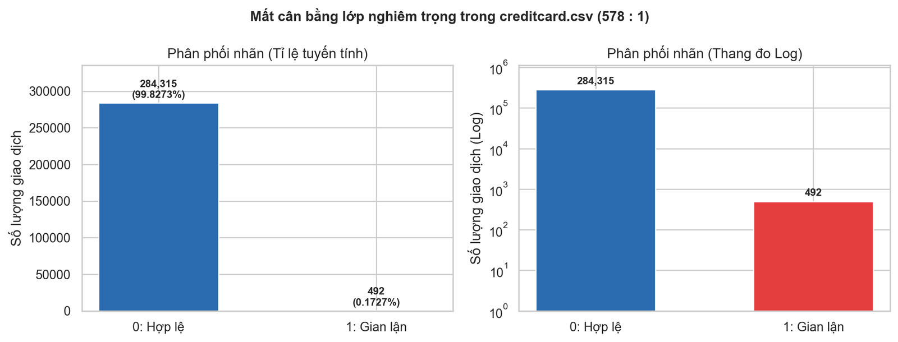
  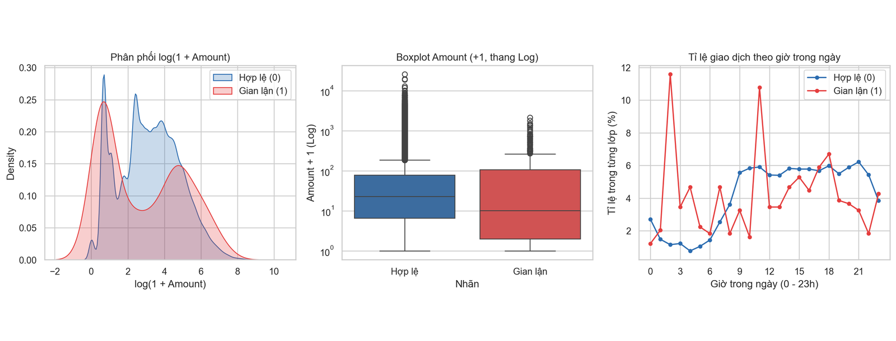
</p>

### 3.2. Mối tương quan & Các đặc trưng tách biệt quan trọng
Phân tích ma trận tương quan cho thấy các đặc trưng như `V14`, `V12`, `V10`, `V4`, `V11` có khả năng phân tách rất rõ ràng giữa hành vi gian lận và giao dịch thông thường.

<p align="center">
  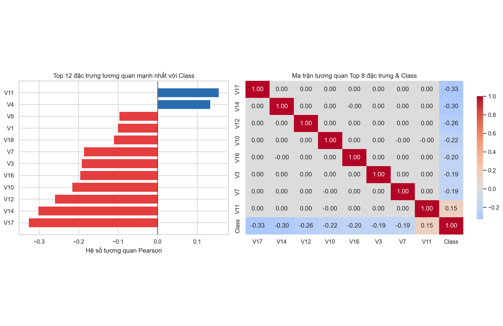
  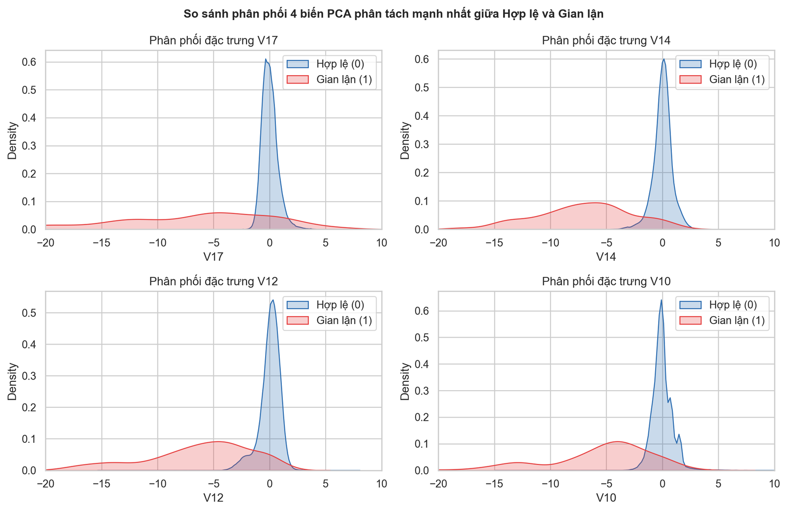
</p>

---

## 4. Tiền xử lý & Kỹ thuật đặc trưng: Luồng A vs Luồng B

Để làm rõ đóng góp của quy trình tiền xử lý, nhóm triển khai thực nghiệm đối chứng giữa hai luồng:  
– **Luồng A (Cơ bản):** Giữ nguyên dữ liệu thô, chuẩn hóa `StandardScaler` đơn thuần.  
– **Luồng B (Cải tiến):**  
  &nbsp;&nbsp;– Khử `1.081` dòng trùng lặp.  
  &nbsp;&nbsp;– Mã hóa chu kỳ thời gian theo ngày: `Hour_sin`, `Hour_cos`.  
  &nbsp;&nbsp;– Biến đổi log số tiền giao dịch: `Log_Amount = log1p(Amount)` & cờ `Is_Zero_Amount`.  
  &nbsp;&nbsp;– Chuẩn hóa kháng nhiễu `RobustScaler` (cho K-NN, Decision Tree) và biến đổi phân phối chuẩn `PowerTransformer (Yeo-Johnson)` cho Gaussian Naive Bayes.  
  &nbsp;&nbsp;– Phân tách `Train / Val / Test` hoàn toàn độc lập trước khi `fit` biến đổi.  

<p align="center">
  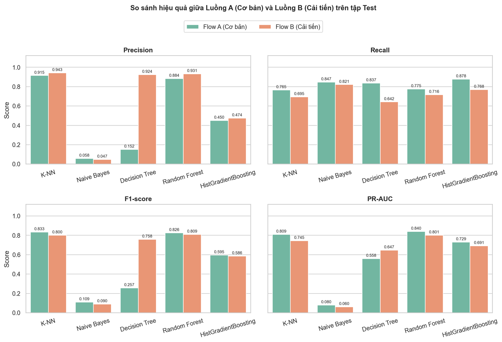
</p>

---

## 5. Tinh chỉnh Siêu tham số & Kết quả Đánh giá Mô hình

### 5.1. Tinh chỉnh siêu tham số (Hyperparameter Tuning)
Nhóm thực hiện dò tìm tham số tối ưu trên tập Validation đối với các mô hình cốt lõi:  
– **K-NN:** Tinh chỉnh số láng giềng $k \in [3, 11]$ và trọng số khoảng cách (`distance` vs `uniform`).  
– **Gaussian Naive Bayes:** Điều chỉnh hệ số làm mịn phương sai `var_smoothing` kết hợp phép biến đổi `PowerTransformer`.  
– **Decision Tree:** Giới hạn độ sâu `max_depth` và tiêu chí phân chia (`gini` vs `entropy`).  

<p align="center">
  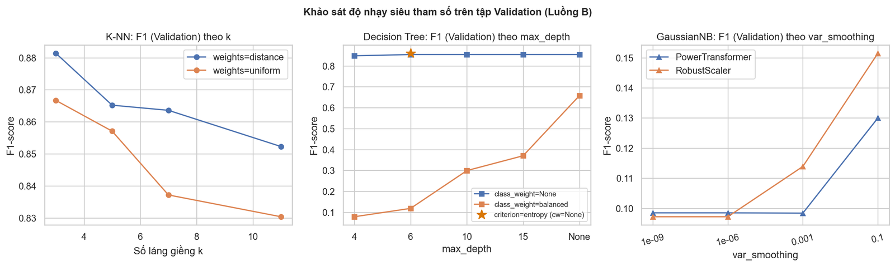
</p>

### 5.2. Bảng tổng hợp so sánh trên tập Test (Độc lập)

| Luồng | Mô hình | Threshold | Precision | Recall | F1-Score | ROC-AUC | PR-AUC |
| :--- | :--- | :---: | :---: | :---: | :---: | :---: | :---: |
| **Flow A** | Baseline: Dummy (Most Frequent) | 0.50 | 0.0000 | 0.0000 | 0.0000 | 0.5000 | 0.0017 |
| **Flow A** | Decision Tree (Mặc định) | 0.50 | 0.7400 | 0.7551 | 0.7475 | 0.8773 | 0.5592 |
| **Flow A** | K-NN ($k=5$, Unscaled) | 0.50 | **1.0000** | 0.0306 | 0.0594 | 0.5953 | 0.0826 |
| **Flow A** | K-NN ($k=5$, Scaled) | 0.50 | 0.9146 | 0.7653 | 0.8333 | 0.9335 | 0.8094 |
| **Flow A** | Gaussian Naive Bayes | 0.50 | 0.0583 | 0.8469 | 0.1091 | 0.9630 | 0.0798 |
| **Flow B** | **K-NN ($k=3$, Distance, Tuned)** | 0.50 | 0.9429 | 0.6947 | 0.8000 | 0.8788 | 0.7446 |
| **Flow B** | Gaussian Naive Bayes (PowerTrans) | 0.95 | 0.0676 | 0.7895 | 0.1246 | 0.9507 | 0.0758 |
| **Flow B** | Decision Tree (Tuned: depth=6) | 0.50 | 0.9242 | 0.6421 | 0.7578 | 0.8988 | 0.6466 |
| **Flow B** | **Random Forest (Ensemble)** | 0.55 | **0.9577** | 0.7158 | **0.8193** | 0.9424 | **0.8014** |
| **Flow B** | **HistGradientBoosting (Ensemble)** | 0.90 | 0.8500 | 0.7158 | 0.7771 | 0.9409 | 0.6911 |

### 5.3. Ma trận nhầm lẫn & Đường cong PR / ROC (Luồng B)

<p align="center">
  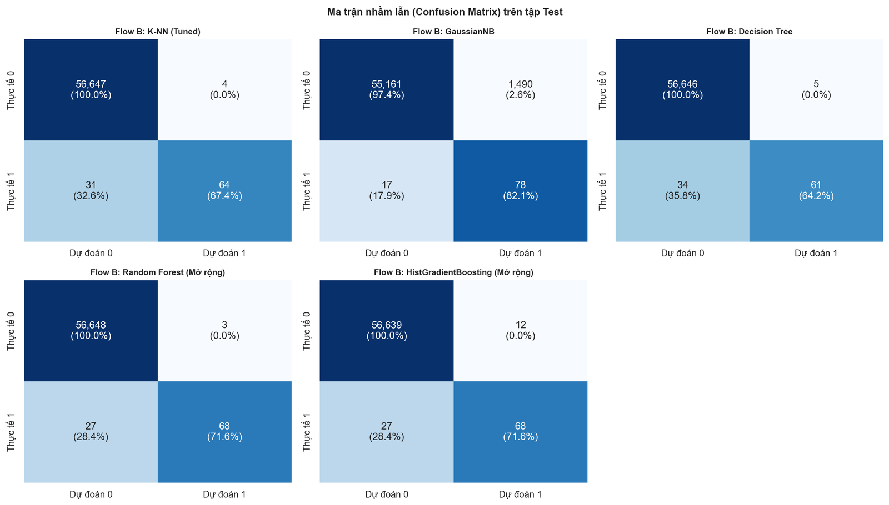
  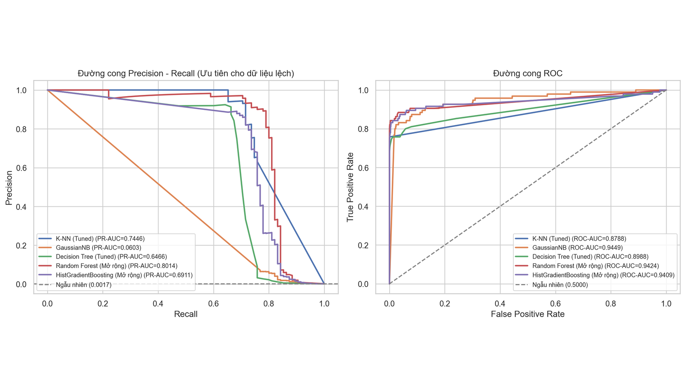
</p>

---

## 6. Phân tích Lỗi (Error Analysis)

Nhóm trích xuất và phân tích định tính các mẫu **False Negative (bỏ lọt gian lận)** và **False Positive (báo động nhầm)**:  
– **False Negative (FN):** Các giao dịch gian lận có giá trị giao dịch rất nhỏ ($< 10\$$) và vector đặc trưng PCA nằm sâu trong vùng phân phối của giao dịch hợp lệ.  
– **False Positive (FP):** Các giao dịch hợp lệ nhưng phát sinh vào khung giờ nhạy cảm kèm biến động số tiền bất thường khiến mô hình kích hoạt cảnh báo giả.  

<p align="center">
  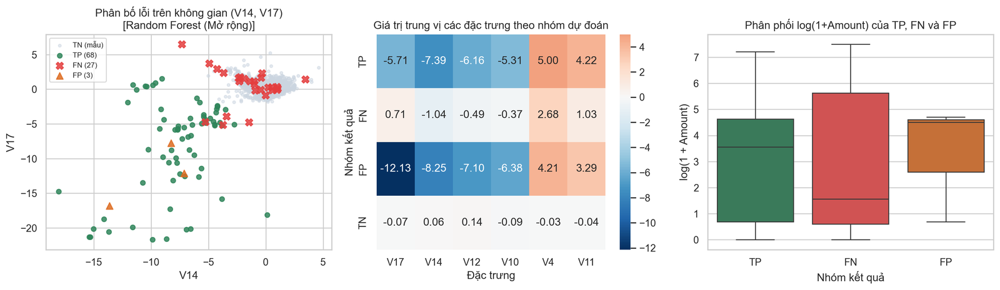
</p>

---

## 7. Giao diện Demo Ứng dụng Web (Interactive Web App)

Nhóm đã xây dựng giao diện trực quan hỗ trợ chuyên viên phòng chống gian lận kiểm tra và phân tích giao dịch theo thời gian thực:  
– Nhập thông số giao dịch hoặc chọn trực tiếp mẫu từ tập Test.  
– Chuyển đổi linh hoạt giữa các mô hình học máy.  
– Điều chỉnh ngưỡng quyết định cảnh báo (`Classification Threshold`) tùy theo chiến lược chấp nhận rủi ro của ngân hàng.  

<p align="center">
  
  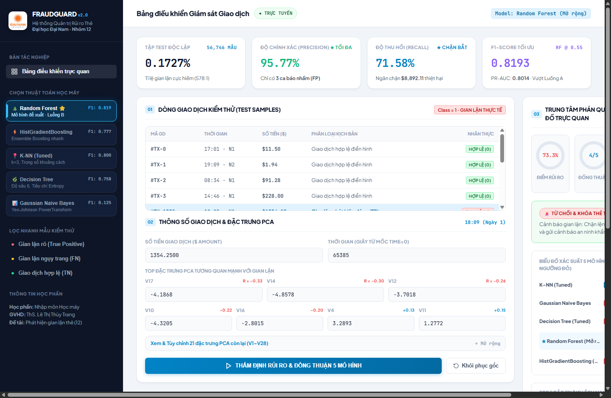
</p>
<p align="center">
  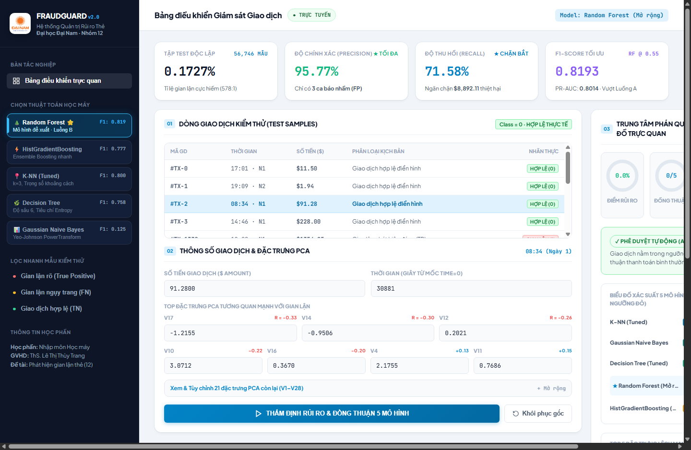
  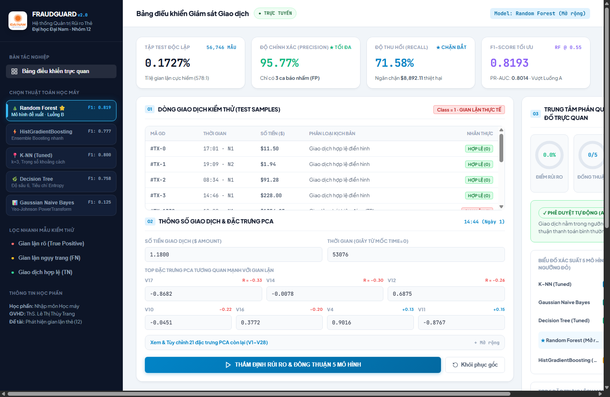
</p>

---

## 8. Cấu trúc Repository

```text
nhom12-credit-card-fraud/
├── README.md
├── AI_USAGE.md                  # Khai báo minh bạch sử dụng công cụ AI
├── requirements.txt             # Thư viện & phiên bản tái tạo môi trường
├── data/
│   └── README.md                # Hướng dẫn tải & đặt tệp creditcard.csv
├── notebooks/
│   ├── 01_eda.ipynb             # Khám phá & phân tích dữ liệu (EDA)
│   ├── 02_experiments.ipynb     # So sánh Luồng A vs Luồng B & các mô hình
│   └── 03_error_analysis.ipynb  # Phân tích lỗi FN/FP & ngưỡng quyết định
├── src/
│   ├── config.py                # Tham số tái tạo (RANDOM_STATE=42) & đường dẫn
│   ├── data_loader.py           # Đọc dữ liệu và kiểm tra schema
│   ├── eda.py                   # Xuất thống kê EDA & biểu đồ
│   ├── preprocessing.py         # Luồng A (Cơ bản) & Luồng B (Cải tiến) chống data leakage
│   ├── models.py                # Baseline, K-NN, GaussianNB, Decision Tree, Ensemble
│   ├── evaluate.py              # Precision, Recall, F1, ROC-AUC, PR-AUC, Confusion Matrix
│   ├── error_analysis.py        # Trích xuất mẫu False Negative / False Positive
│   └── run_pipeline.py          # Chạy toàn bộ pipeline tái tạo kết quả end-to-end
├── app/
│   ├── app.py                   # Backend dịch vụ demo dự đoán giao dịch gian lận
│   └── index.html               # Giao diện web người dùng tương tác
├── outputs/
│   ├── figures/                 # Hình ảnh, biểu đồ EDA, mô hình & ảnh demo web
│   ├── metrics/                 # Bảng kết quả (.csv) & log thông số (.json)
│   └── models/                  # Mô hình đã lưu (.joblib) phục vụ Demo
└── report/
    ├── main.tex                 # Báo cáo khoa học LaTeX (6 phần theo quy định)
    ├── references.bib           # Tài liệu tham khảo
    └── figures/                 # Hình ảnh biểu đồ phục vụ biên dịch PDF báo cáo
```

---

## 9. Hướng dẫn cài đặt & Tái tạo kết quả

### Bước 1: Cài đặt thư viện môi trường
```bash
pip install -r requirements.txt
```

### Bước 2: Chuẩn bị dữ liệu
Đặt tệp `creditcard.csv` vào `data/creditcard.csv` (hoặc truyền qua tham số `--data-path`).

### Bước 3: Chạy toàn bộ pipeline học máy (`random_state=42`)
```bash
python -m src.run_pipeline --data-path "data/creditcard.csv"
```
Lệnh trên sẽ tự động:  
– Phân tích dữ liệu (EDA) và xuất các biểu đồ trực quan vào `outputs/figures/`.  
– Phân chia dữ liệu `Train / Validation / Test` (`60% / 20% / 20%`) **trước khi** `fit` bộ chuẩn hóa để ngăn ngừa hoàn toàn Data Leakage.  
– Thực hiện tiền xử lý và huấn luyện so sánh Luồng A và Luồng B.  
– Tinh chỉnh siêu tham số và đánh giá các mô hình K-NN, Naive Bayes, Decision Tree, Random Forest, HistGradientBoosting.  
– Xuất báo cáo bảng số liệu `outputs/metrics/model_comparison.csv` và gói mô hình `outputs/models/demo_bundle.joblib`.  

### Bước 4: Khởi chạy ứng dụng Web Demo
```bash
python app/app.py
```
Mở trình duyệt truy cập: `http://127.0.0.1:8501` để trải nghiệm trực tiếp giao diện.

---

## 10. Lưu ý Liêm chính học thuật
Xem chi tiết bản khai báo minh bạch quá trình sử dụng công cụ AI tại [AI_USAGE.md](AI_USAGE.md).
